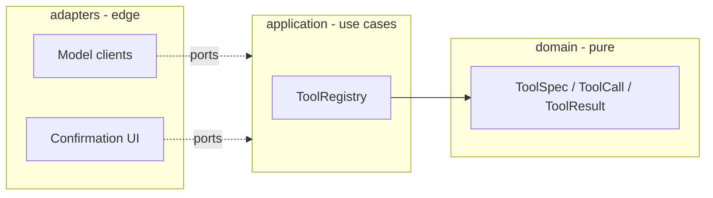

# agent-harness

A readable agent harness built from scratch in Python: typed tools, guardrails, a budgeted
agent loop, context compaction, memory, sub-agents, hooks, a model router, tracing and evals.

[](https://github.com/jorgitobg/agent-harness/actions/workflows/ci.yml)


## Why this exists

Tools like Claude Code, Codex or Hermes all run on the same machinery: a tool registry, a
model loop with limits, context management, permission checks and tracing. Frameworks
hide those parts. This repository builds them one at a time, small enough to read in one
sitting, so that every design decision can be seen, tested and argued about.

## Status

Early and built in the open, one user story per pull request.

| Story | What | State |
|---|---|---|
| US1 | Typed tool registry with JSON Schema validation | ✅ done |
| US2 | Permission levels, allow/deny lists, human confirmation | planned |
| US3 | Agent loop with step / token / cost / time budgets | planned |
| US4 | Context compaction | planned |
| US5 | Pre/post tool hooks | planned |
| US6 | Sub-agents with isolated context | planned |
| US7 | Model router with fallback (cloud ↔ local OpenAI-compatible) | planned |
| US8 | Tracing, replay and evals | planned |

Full spec with acceptance criteria: [docs/spec/0001-agent-harness.md](docs/spec/0001-agent-harness.md).

## Architecture



Dependencies point inward only. The domain has no I/O; adapters translate to provider formats.

## Quickstart

```bash
python -m venv .venv && . .venv/bin/activate
pip install -e '.[dev]'
pytest
```

```python
from agent_harness.application.registry import ToolRegistry
from agent_harness.domain.tools import ToolCall, ToolSpec

registry = ToolRegistry()
registry.register(
    ToolSpec(
        "add",
        "Add two integers.",
        {
            "type": "object",
            "properties": {"a": {"type": "integer"}, "b": {"type": "integer"}},
            "required": ["a", "b"],
            "additionalProperties": False,
        },
    ),
    lambda args: args["a"] + args["b"],
)

registry.dispatch(ToolCall("c1", "add", {"a": 2, "b": 3})).for_model()
# {'ok': True, 'output': 5}
registry.dispatch(ToolCall("c2", "add", {"a": "two"})).for_model()
# {'ok': False, 'error': 'invalid_arguments', 'message': ..., 'issues': [...]}
```

Model mistakes never raise: they come back as structured results the model can read and fix.

## Design decisions

- [ADR 0001](docs/adr/0001-hexagonal-core-without-agent-framework.md) — hexagonal core, no agent framework: more code, but every concept is visible and testable.
- [ADR 0002](docs/adr/0002-json-schema-for-tool-arguments.md) — JSON Schema as the tool contract: the same schema goes to the model, to validation and to MCP.

## How this is built

Spec first, then one pull request per story, each with tests, strict typing (pyright strict),
ruff and secret scanning in CI. AI-assisted, human-reviewed.

## License

Apache-2.0
