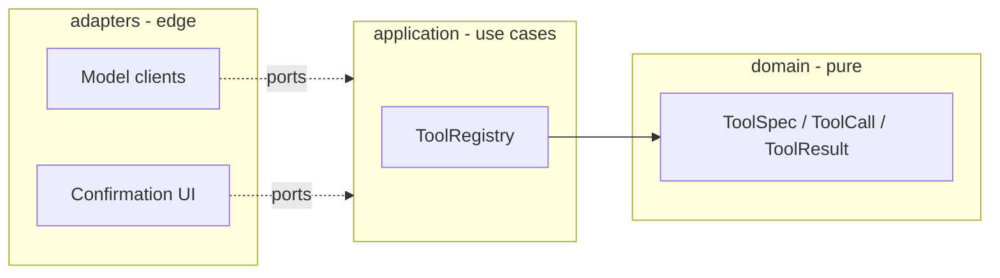

# agent-harness

A readable agent harness built from scratch in Python: typed tools, guardrails, a budgeted
agent loop, context compaction, memory, sub-agents, hooks, a model router, tracing and evals.

[](https://github.com/jorgitobg/agent-harness/actions/workflows/ci.yml)


## Why this exists

Tools like Claude Code, Codex or Hermes all run on the same machinery: a tool registry, a
model loop with limits, context management, permission checks and tracing. Frameworks
hide those parts. This repository builds them one at a time, small enough to read in one
sitting, so that every design decision can be seen, tested and argued about.

## Status

Early and built in the open, one user story per pull request.

| Story | What | State |
|---|---|---|
| US1 | Typed tool registry with JSON Schema validation | ✅ done |
| US2 | Permission levels, allow/deny lists, human confirmation | ✅ done (CLI prompt adapter pending) |
| US3 | Agent loop with step / token / cost / time budgets, typed stop reasons | ✅ done |
| US4 | Context compaction (token estimator, keep task + last N, summary via model port) | ✅ done |
| US5 | Pre/post tool hooks (block, rewrite args, redact output; fail closed) | ✅ done (wired into the demo: secret redaction) |
| US6 | Sub-agents with isolated context | planned |
| US7 | Model router with fallback (cloud ↔ local OpenAI-compatible) | ✅ router done (rule-based: failed tool or long transcript → strong tier; fallback on error; wired into `--router` demo). Not done: cost/latency-aware routing, real-model evaluation of the heuristic |
| US8 | Tracing, replay and evals | planned |

Full spec with acceptance criteria: [docs/spec/0001-agent-harness.md](docs/spec/0001-agent-harness.md).

## Architecture



Dependencies point inward only. The domain has no I/O; adapters translate to provider formats.

## Quickstart

```bash
python -m venv .venv && . .venv/bin/activate
pip install -e '.[dev]'
pytest
```

```python
from agent_harness.application.registry import ToolRegistry
from agent_harness.domain.tools import ToolCall, ToolSpec

registry = ToolRegistry()
registry.register(
    ToolSpec(
        "add",
        "Add two integers.",
        {
            "type": "object",
            "properties": {"a": {"type": "integer"}, "b": {"type": "integer"}},
            "required": ["a", "b"],
            "additionalProperties": False,
        },
    ),
    lambda args: args["a"] + args["b"],
)

registry.dispatch(ToolCall("c1", "add", {"a": 2, "b": 3})).for_model()
# {'ok': True, 'output': 5}
registry.dispatch(ToolCall("c2", "add", {"a": "two"})).for_model()
# {'ok': False, 'error': 'invalid_arguments', 'message': ..., 'issues': [...]}
```

Model mistakes never raise: they come back as structured results the model can read and fix.

### Against a real model (OpenAI-compatible endpoint)

`OpenAICompatModel` implements the model port for any chat-completions endpoint with tool calling (hosted services, OpenRouter, llama.cpp, Ollama). Standard library only; https is required except for `localhost`.

```bash
AGENT_HARNESS_API_KEY=... python -m agent_harness.live \
  --base-url https://openrouter.ai/api/v1 --model <model-name> \
  "Search my notes for the word 'story' and tell me the title of the matching note."
```

The key comes from the environment only. The example agent can read notes but has no operator attached, so its writes are refused.

How it was checked, and what that does and does not show:
- The test suite never touches the network. The contract tests replay a **conversation recorded from a real run** (a free-tier model on OpenRouter, 2026-11-05: the model asked for `search_notes`, the harness returned the result, the model answered). The tests assert that the requests the adapter builds are identical to the ones the real service accepted. The fixture holds no headers or credentials.
- The same command was run live against that model and answered correctly in 2 steps. With `--max-tokens 40` the model spent its whole budget on hidden reasoning and returned nothing; the adapter reports that as a typed `model_error` stop (`token budget exhausted`) and the key never appears in output.
- One free model on one day is an anecdote, not a benchmark. Another free model returned `429` (rate limited) in the same session, which is reported the same typed way. Error messages carry a status code or a short reason, never request or response bodies.

### Offline demo (no keys, no network)

```bash
python -m agent_harness.demo          # operator approves the write
python -m agent_harness.demo --deny   # operator refuses the write
python -m agent_harness.demo --router # cheap tier down, router falls back
```

Real loop, registry, guardrails and budgets, driven by a scripted model with two in-memory
tools: `search_notes` (read, allowed) and `write_note` (write, asks the operator first).
Output of the three runs, pasted verbatim from the commands above (`--router` puts a cheap
tier that is down in front of the scripted model; the US7 router falls back to the strong tier):

```text
$ python -m agent_harness.demo
operator answer to confirmations: yes
  tool search_notes: ok -> ['todo']
  tool read_note: ok -> Staging login uses token [REDACTED] (fake, for the redaction demo).
  tool write_note: ok -> saved note 'plan'
confirmations asked: [('write_note', 'write')]
stop_reason=final_answer steps=4
final_answer="Done: the plan is saved as note 'plan'."
notes now: ['deploy', 'plan', 'todo', 'welcome']

$ python -m agent_harness.demo --deny
operator answer to confirmations: no
  tool search_notes: ok -> ['todo']
  tool read_note: ok -> Staging login uses token [REDACTED] (fake, for the redaction demo).
  tool write_note: refused/failed (denied) -> operator refused tool 'write_note'
confirmations asked: [('write_note', 'write')]
stop_reason=final_answer steps=4
final_answer="Done: the plan is saved as note 'plan'."
notes now: ['deploy', 'todo', 'welcome']

$ python -m agent_harness.demo --router
operator answer to confirmations: yes
  tool search_notes: ok -> ['todo']
  tool read_note: ok -> Staging login uses token [REDACTED] (fake, for the redaction demo).
  tool write_note: ok -> saved note 'plan'
confirmations asked: [('write_note', 'write')]
stop_reason=final_answer steps=4
final_answer="Done: the plan is saved as note 'plan'."
notes now: ['deploy', 'plan', 'todo', 'welcome']
model routes: ['cheap->strong', 'cheap->strong', 'cheap->strong', 'cheap->strong']
```

Note the last line of the `--deny` run: the scripted model does not read tool results, so it
still claims success. The guard did its job (`notes now` has no `plan`). A real model would
read the `denied` result and react; the harness does not rely on the model to enforce policy.

## Design decisions

- [ADR 0001](docs/adr/0001-hexagonal-core-without-agent-framework.md) — hexagonal core, no agent framework: more code, but every concept is visible and testable.
- [ADR 0002](docs/adr/0002-json-schema-for-tool-arguments.md) — JSON Schema as the tool contract: the same schema goes to the model, to validation and to MCP.

## How this is built

Spec first, then one pull request per story, each with tests, strict typing (pyright strict),
ruff and secret scanning in CI. AI-assisted, human-reviewed.

## License

Apache-2.0
